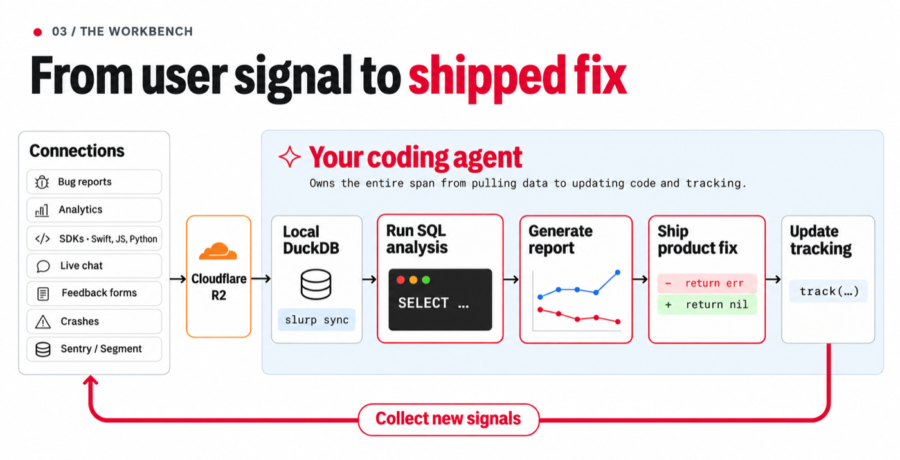
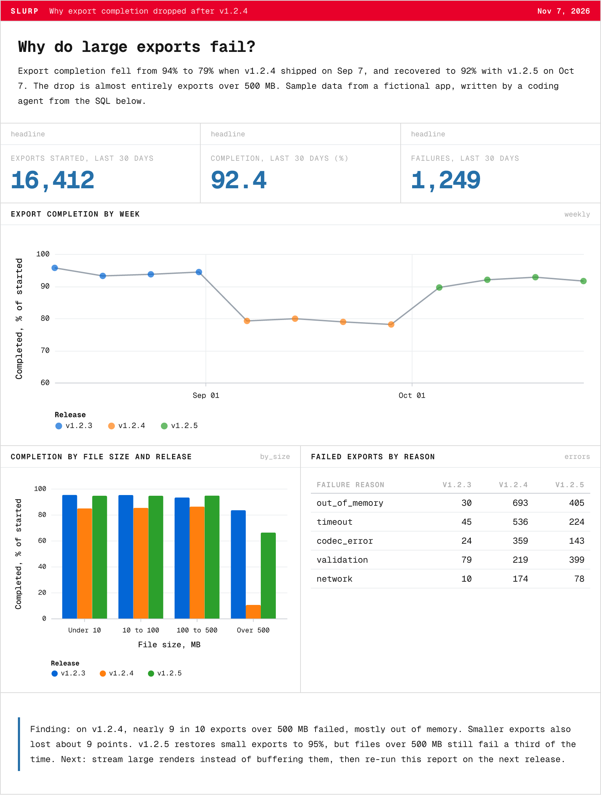
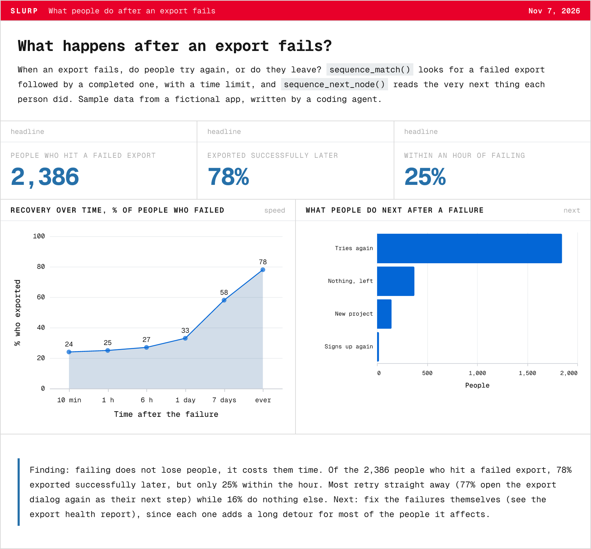

<p align="center">
  
</p>

<h1 align="center"></h1>

<p align="center"><a href="https://deploy.workers.cloudflare.com/?url=https%3A%2F%2Fgithub.com%2FhitSlop%2Fslurp%2Ftree%2Fmaster%2Fbackend"></a></p>

<p align="center"><b>Product analytics for coding agents, in your own Cloudflare account.</b></p>
<p align="center">Events in your Cloudflare account &nbsp;→&nbsp; <a href="https://duckdb.org"></a> <a href="https://duckdb.org"><b>DuckDB</b></a> on your machine &nbsp;→&nbsp; your coding agent</p>
<p align="center">
  <a href="https://github.com/hitSlop/slurp/actions/workflows/check.yml"></a>
  <a href="LICENSE"></a>
  <a href="https://github.com/hitSlop/slurp/stargazers"></a>
  <a href="https://discord.gg/jprRVWSRdn"></a>
</p>
<!-- sdk-badges:start (generated by apps/site/scripts/readme-badges.mjs) -->
<p align="center">
  <b>Capture from</b>&nbsp; 
  
  
  
  
  
  <br>
  <b>Keep using</b>&nbsp; 
  
  
  <br>
  <b>Coming</b>&nbsp; 
  
</p>
<p align="center"><sub>Logos are trademarks of their owners, used only to show compatibility.</sub></p>
<!-- sdk-badges:end -->

Bring your events home. Capture application events into **your own Cloudflare account**, sync them into a local DuckDB file, and give your coding agent raw data for product analysis and reports.

```
your app ──► Worker + Durable Objects ──► R2 archives      (in your Cloudflare account)
                                              │
                              slurp sync ◄────┘   (verified, idempotent)
                                   │
                                   ▼
            DuckDB on your machine ──► SQL, reports, your coding agent
```

No servers to run, no data leaving your account. The Cloudflare Free plan is enough to start.

## From user signal to shipped fix

<p align="center">
  
</p>

Your coding agent owns the whole span: it pulls the data, analyzes it with SQL, writes the report, ships the fix and updates the tracking so the next round of signals arrives. Today the JavaScript and React Native SDKs, HTTP, the Segment and Sentry SDKs you already use (Swift and Python included) and GitHub, Stripe and RevenueCat webhooks work; the other inputs in the picture (bug reports, chat, readable crash traces, other analytics tools, more SDKs) are on the roadmap, see [Connections](https://slurp.run/connections/).

## What your agent generates

Ask your agent a question about your product. It writes one Markdown file: the SQL, the charts and the finding in plain words. `slurp report build` turns it into a page you can open, a PNG you can post to Slack, and a PDF. Two examples, from sample data (click one to open the live version):

<table>
  <tr>
    <td width="50%" valign="top">
      <a href="https://slurp.run/reports/export-health/"></a>
    </td>
    <td width="50%" valign="top">
      <a href="https://slurp.run/reports/recovery/"></a>
    </td>
  </tr>
</table>

The [source of the first one](examples/demo/export-health.md) is a plain Markdown file, and [reports](docs/reports.md) explains the format.

## What it costs

<!-- pricing:start (generated by apps/site/scripts/readme-pricing.mjs) -->
| Monthly USD, by events per month | 1M | 10M | 50M | 100M | 1B | 10B |
|---|--:|--:|--:|--:|--:|--:|
| [**Slurp, self-hosted on Cloudflare**](docs/self-hosting.md#costs-and-limits) | **Free** | **$0.43** | **$7.96** | **$11.21** | **$42 to $280** | **$420 to $3,200** |
| [PostHog · Product Analytics](https://posthog.com/docs/product-analytics/pricing) | Free | $324.40 | $1,528.40 | $2,618.40 | $11,618.40 | $92,618.40 |
| [Mixpanel · Growth (yearly billing)](https://mixpanel.com/pricing/) | Free | $840 | Contact sales | Contact sales | Contact sales | Contact sales |
| [Amplitude · Plus](https://amplitude.com/pricing) | Free | Not published | Not published | Not published | Not published | Not published |
| [OpenPanel · Cloud (monthly)](https://openpanel.dev/pricing) | $90 | $350 | $900 | Custom plan | Custom plan | Custom plan |

*Vendor prices read from their public pricing pages on November 6, 2026; they change, so check before deciding. Mixpanel is yearly billing. Amplitude does not publish paid event prices, and Mixpanel and OpenPanel direct high volumes to sales.*

The Slurp row is the Cloudflare bill for running your own Worker, not a Slurp fee: 20 events per request, about 320 bytes stored per event, 12 months of archives kept, at Cloudflare's list prices (the Workers Free plan covers you until about 50K requests a day). The 1B and 10B figures are ranges, extrapolated from load tests of about 5,000 events a second per project, not months of running those volumes; about two thirds of the bill is R2 storage, so event size and retention matter most. Details: [docs/self-hosting.md](docs/self-hosting.md#costs-and-limits).
<!-- pricing:end -->

## Quickstart

[](https://deploy.workers.cloudflare.com/?url=https%3A%2F%2Fgithub.com%2FhitSlop%2Fslurp%2Ftree%2Fmaster%2Fbackend)

One click deploys the Worker, Durable Objects and R2 bucket to your Cloudflare account (you choose an `ADMIN_TOKEN`). Then open the Worker's address: it shows the command that connects the CLI. Or do it all from a terminal (to build the CLI from source instead, see [Development](#development)):

```sh
# 1. Install the CLI (macOS or Linux), then deploy your Worker (needs a Cloudflare account and Node 20+)
curl -LsSf https://slurp.run/install | sh
# or: npm install -g @hitslop/slurp
slurp cloud init             # logs in, creates the bucket, deploys the Worker, connects this computer
slurp setup                  # once per computer: library folder and DuckDB

# 2. In your app (npm install @hitslop/slurp-sdk to capture from code, or send from the CLI)
cd /path/to/your/app
slurp init --name "My app"   # connects this app, opens its quickstart page with your keys
slurp send signed_up --user-id demo_alice --data '{"demo":true}'
slurp sync --now             # publishes what the Worker has buffered (admin token), then imports it
slurp sql 'SELECT event, count(*) AS n FROM events GROUP BY event'
```

Each project is one event stream on your Worker (many sources can write to it: a website, an app, a webhook) bound to one DuckDB file, stored locally or on an external drive. SQL, report definitions and project metadata stay with your app. No daemon is required. DuckDB 2.x is used for analysis.

## Send events

Every way lands in the same place: your Worker accepts the event durably, and `slurp sync` can read it after the Worker next publishes an archive (about 10 minutes by default, or at once with `slurp sync --now`). You do not make the endpoint or the key by hand: `slurp init` creates your project on the Worker together with its first publishable key, and prints your ingest URL and that key. Those two values are all an SDK needs. A publishable key can only send events, so it is safe in a web page or an app. `slurp project setup PROJECT` shows them again, and `slurp project key create PROJECT --scope publishable --source ios` makes one key per source (`web`, `ios`, `github`...), and the source is stamped on every event as `sender`. [Where they come from](docs/sdks.md#where-the-endpoint-and-key-come-from).

| Send from | Install | Status |
|---|---|---|
| **JavaScript / TypeScript** (browser, Node) | `npm install @hitslop/slurp-sdk` | Published |
| **React Native / Expo** | `npm install @hitslop/slurp-react-native @react-native-async-storage/async-storage` | Tested against fakes; not yet run on a device |
| **Swift** (iOS, macOS, tvOS, watchOS) | Segment's `analytics-swift` (Xcode: add `https://github.com/segmentio/analytics-swift`), with both hosts set to your Worker (below) | There is no Slurp Swift SDK |
| **Segment SDKs** you already use | Change the host to your Worker (below) | Verified with analytics-node, analytics-next, analytics-swift and `segment-analytics-python` |
| **Sentry SDKs** you already use | Change the DSN to your Worker (below) | Verified with `@sentry/node`, `@sentry/browser` and `sentry-sdk` for Python |
| **Python** | `pip install segment-analytics-python` or `sentry-sdk`, then change the host or DSN | Both run unmodified against a Worker on Python 3.9, 3.12 and 3.14; there is no native Python SDK |
| **HTTP**, any language | `POST /v1/events` | Tested |
| **The CLI** | `slurp send`, `slurp identify` | Tested |

Coming, with no dates: first-party **Rust** and **Kotlin (Android)** SDKs, and local symbolication of Sentry stack traces in the CLI. Other Segment and Sentry SDKs (Kotlin, Go, Cocoa, Android...) speak the same protocols and should work with the same URL change, but are untested, so they are not claimed. Full recipes and limits: [docs/sdks.md](docs/sdks.md).

**JavaScript SDK** (browser and Node, with a durable queue, batching and retries):

```js
import { init, track, identify, flush } from '@hitslop/slurp-sdk';

init({
  endpoint: 'https://slurp.YOUR-SUBDOMAIN.workers.dev/v1/events',
  key: 'slurp_pk_…',
});

identify('user_42', { plan: 'pro' });
track('signed_up', { plan: 'pro' });
track('feedback', { message: 'Exporting a 4K video fails at 90%', rating: 2 }); // feedback is just another event (or mount the drop-in widget: @hitslop/slurp-sdk/feedback)
await flush(); // in scripts, send queued events before exiting
```

**React Native / Expo**: events are kept in AsyncStorage, so they survive the app being killed, and are sent when the app goes to the background:

```ts
import { init, track, screen } from '@hitslop/slurp-react-native';

init({ endpoint: 'https://slurp.YOUR-SUBDOMAIN.workers.dev/v1/events', key: 'slurp_pk_…' });
screen('Home');
track('purchase_completed', { total: 49 });
```

**Swift** (iOS, macOS): use Segment's `analytics-swift` and point it at your Worker. Set **both** `apiHost` and `cdnHost`: without `cdnHost` the SDK fetches its settings from Segment's CDN and can send events there instead.

```swift
import Segment

let configuration = Configuration(writeKey: "slurp_pk_…")
    .apiHost("slurp.YOUR-SUBDOMAIN.workers.dev/v1")
    .cdnHost("slurp.YOUR-SUBDOMAIN.workers.dev/v1")
let analytics = Analytics(configuration: configuration)
analytics.screen(title: "Home")
analytics.track(name: "purchase_completed", properties: ["total": 49])
```

**GitHub, Stripe, RevenueCat or any webhook?** `slurp project webhook PROJECT github` prints a URL and a secret to paste into the provider. Releases, deployments, payments and app purchases then arrive as events (named for the sender, stored whole), a `releases` view lists GitHub releases and deployments so a metric change can be lined up with the release behind it, and a `revenue` view lists RevenueCat purchases and renewals. Preview: [docs/webhooks.md](docs/webhooks.md).

**Already using Segment?** Keep the SDK and point it at your Worker. Your publishable key is the write key; `page`, `screen`, `group` and `alias` are stored as `track` events with those names:

```js
// Node (@segment/analytics-node)
const analytics = new Analytics({ writeKey: 'slurp_pk_…', host: 'https://slurp.YOUR-SUBDOMAIN.workers.dev', path: '/v1/batch' });
// Browser (@segment/analytics-next)
const [analytics] = await AnalyticsBrowser.load({ writeKey: 'slurp_pk_…', cdnURL: 'https://slurp.YOUR-SUBDOMAIN.workers.dev' });
```

**Already using Sentry?** Change the DSN. Errors are stored whole as `error` events and read with the `errors` view; there is no symbolication or issue UI. The DSN's public key is your publishable key as is (the setup page shows the finished DSN):

```js
Sentry.init({ dsn: 'https://slurp_pk_…@slurp.YOUR-SUBDOMAIN.workers.dev/1' });
```

```sql
SELECT group_key, any_value(exception_type) AS type, count(*) AS n FROM errors GROUP BY group_key ORDER BY n DESC;
```

**The CLI**, from your app's folder (handy for testing, scripts and cron jobs). It asks your Worker for the publishable key of the `cli` source, so the events carry `sender = 'cli'`; this needs the saved admin connection (or `SLURP_PUBLISHABLE_KEY`):

```sh
slurp send signed_up --user-id user_42 --data '{"plan":"pro"}'
slurp identify user_42 --data '{"plan":"pro"}'
slurp send --stdin < events.ndjson        # NDJSON records from a file or a pipeline (give each an "id")
slurp sync --now                          # publish what the Worker has buffered, then import it
```

**HTTP from any language**: POST one JSON object to `/v1/events`. Only `event` is required:

```sh
curl -X POST "https://slurp.YOUR-SUBDOMAIN.workers.dev/v1/events?key=slurp_pk_…" --data-binary '{"event":"signed_up"}'
# the Worker answers {"ok":true,"accepted":1}
slurp sync --now    # publish it and import it, to see it right away
```

The key can also go in an `Authorization: Bearer slurp_pk_…` header. Send several records as NDJSON, one object per line; if any line is invalid nothing is stored and the `400` lists every bad line. Add an `id` (and `user_id`, `timestamp`, `data`) when you have them: a record without an `id` is a new event every time it is sent, while the same `id` from the same source is stored once, so give each event an `id` to make a retry safe (the SDKs and `slurp send` always do). The record format is in [docs/contracts.md](docs/contracts.md#sending-events-post-v1events).

## Connect your agent

```sh
slurp agent setup --out .agents/skills/slurp        # skills for any coding agent that runs commands
claude mcp add slurp -- slurp mcp --project "$PWD" # or MCP: Claude Code, Cursor, Codex, Claude Desktop, Windsurf
```

`slurp mcp` lets an AI client describe the schema, run read-only SQL (in a sandbox that cannot read local files), sync and build reports; `--allow-send` also lets it send events, with `sender = 'mcp'` (filter them out with `WHERE sender <> 'mcp'`). To post results to your team, `slurp notify slack --channel C0123ABCD --file report/report.png --text "Weekly report"` (Slack bot token) or `slurp notify discord ...` (webhook), run from cron for a scheduled report. Tools, config for each client and a schedule recipe: [docs/integrations.md](docs/integrations.md).

## Community

Questions, ideas and show-and-tell: [Discord](https://discord.gg/jprRVWSRdn). Bugs and feature requests: [GitHub issues](https://github.com/hitSlop/slurp/issues). The site is [slurp.run](https://slurp.run).

## Repository

| Path | What |
|---|---|
| `backend/` | The Worker (TypeScript): ingest, archives, control plane. Self-contained so it can be deployed on its own. |
| `crates/` | Rust CLI (`slurp-cli`), client and archive reader (`slurp-client`), Markdown reports (`slurp-document`, `slurp-render`) |
| `sdks/` | SDKs: [`js`](sdks/js), [`react-native`](sdks/react-native) and the delivery scenarios every SDK runs ([`conformance`](sdks/conformance)) |
| `apps/site` | The public site (home, docs, self-host page, cost comparison) |
| `apps/setup` | The private offline setup page `slurp init` opens (built into the CLI as `setup.html`) |
| `docs/` | [Documentation](docs/README.md) |

## Development

```sh
pnpm install                      # website, landing, SDK
pnpm --filter slurp-setup build   # the quickstart page the CLI embeds (crates/slurp-cli/assets/setup.html)
pnpm --filter slurp-site build
SLURP_TEST_DUCKDB=$HOME/.slurp/bin/duckdb cargo test --workspace   # includes a check that backend/src/api.gen.ts is current
(cd backend && npm install && npm run test:worker)   # the Worker's tests, inside workerd (Vitest); seconds
(cd backend && npm run test:http)                      # the real CLI and Python/Swift SDKs against wrangler dev (npm test runs both)
(cd sdks/js && node --test test/*.test.ts)
SLURP_UPDATE_BINDINGS=1 cargo test -p slurp-client api_bindings   # regenerate backend/src/api.gen.ts after changing crates/slurp-client/src/api.rs
```

The control API types are defined once, in Rust (`crates/slurp-client/src/api.rs`), and exported to TypeScript. The wire contracts are in [docs/contracts.md](docs/contracts.md).

The native CLI tests need a DuckDB 2 executable in `SLURP_TEST_DUCKDB`: on a developer machine they are skipped without it, and in CI (`CI` is set) a missing one fails the run. The CLI contract test in `backend/test/http` needs `cargo build -p slurp-cli` and `SLURP_DUCKDB` (default `~/.slurp/bin/duckdb`); it skips cleanly without them.

## License

MIT. See [LICENSE](LICENSE).
